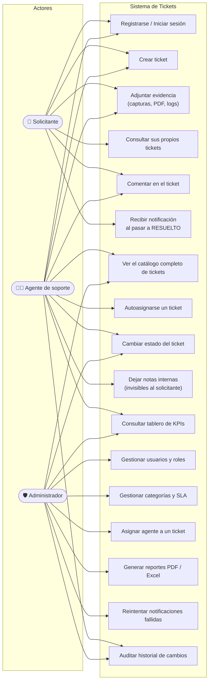
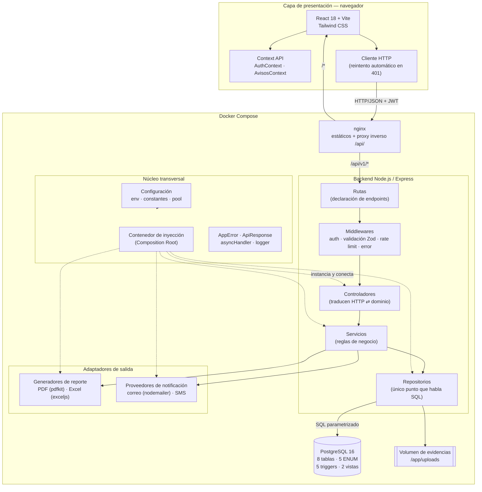
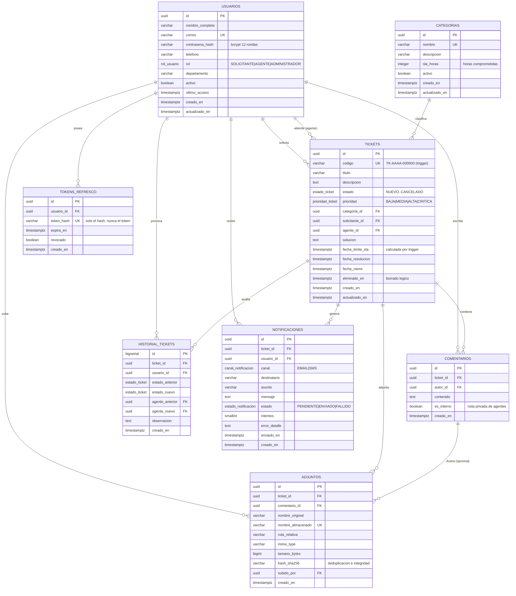

# Sistema de Tickets — Helpdesk Empresarial

> Aplicación web completa para la gestión de incidencias y solicitudes de soporte.
> Los usuarios levantan tickets con evidencia adjunta; los agentes y administradores
> los atienden, resuelven y explotan en reportes PDF/Excel, con notificación
> automática al solicitante cuando el ticket pasa a **RESUELTO**.

**Stack:** Node.js 22 · Express 4 · PostgreSQL 16 · React 18 · Vite 5 · Tailwind CSS 3 · Docker

> ### ¿Primera vez en el proyecto?
>
> - **Para levantarlo y probarlo:** salta directo a la sección
>   [4. Puesta en marcha local con Docker](#4-puesta-en-marcha-local-con-docker).
>   Solo necesitas Docker Desktop en ejecución y 5 comandos.
> - **Para entender qué es cada archivo:** lee
>   **[`docs/GUIA-DE-ARCHIVOS.md`](docs/GUIA-DE-ARCHIVOS.md)** — explica los 133
>   archivos uno por uno, traza el recorrido completo de una petición y lista lo
>   que queda pendiente.
> - **Para preparar la sustentación:** lee
>   **[`docs/GUIA-DE-PRUEBAS-Y-DEMO.md`](docs/GUIA-DE-PRUEBAS-Y-DEMO.md)** — el
>   guion de demo paso a paso, las cuatro pruebas que puedes ejecutar en vivo y
>   las diez preguntas más probables con su respuesta. Para el discurso
>   comercial, **[`docs/ESTRATEGIA-COMERCIAL-Y-DEFENSA.md`](docs/ESTRATEGIA-COMERCIAL-Y-DEFENSA.md)**.
> - **Si te preguntan «¿esto escala?»:** lee
>   **[`docs/RENDIMIENTO.md`](docs/RENDIMIENTO.md)** — la medición real con k6,
>   el cuello de botella encontrado y las recomendaciones de escalado.
> - **Para cerrar el alcance con el profesor:** usa
>   **[`docs/PREGUNTAS-PARA-EL-PROFESOR.md`](docs/PREGUNTAS-PARA-EL-PROFESOR.md)**
>   — 68 preguntas organizadas por tema, cada una con el motivo para hacerla y
>   con lo que el proyecto ya tiene para responderla.

---

## Tabla de contenidos

1. [Descripción del proyecto](#1-descripción-del-proyecto)
2. [Características principales](#2-características-principales)
3. [Diagramas](#3-diagramas)
   - [3.1 Diagrama de casos de uso](#31-diagrama-de-casos-de-uso-usuarios-vs-administradores)
   - [3.2 Diagrama de arquitectura de componentes](#32-diagrama-de-arquitectura-de-componentes)
   - [3.3 Diagrama entidad-relación (ERD)](#33-diagrama-entidad-relación-erd)
4. [Puesta en marcha local con Docker](#4-puesta-en-marcha-local-con-docker)
5. [Despliegue en la nube](#5-despliegue-en-la-nube)
6. [Estructura del repositorio](#6-estructura-del-repositorio)
7. [Referencia de la API](#7-referencia-de-la-api)
8. [Pruebas](#8-pruebas)
9. [Credenciales de demostración](#9-credenciales-de-demostración)
10. [Decisiones de arquitectura](#10-decisiones-de-arquitectura-solid-kiss-dry)
11. [Estrategia comercial y defensa ante cliente hostil](#11-estrategia-comercial-y-defensa-ante-cliente-hostil)
12. [Guía de archivos y pendientes](docs/GUIA-DE-ARCHIVOS.md) *(documento aparte)*
13. [Guía de pruebas y demo en vivo](docs/GUIA-DE-PRUEBAS-Y-DEMO.md) *(documento aparte)*
14. [Informe de rendimiento y escalado](docs/RENDIMIENTO.md) *(documento aparte)*
15. [Preguntas para el profesor](docs/PREGUNTAS-PARA-EL-PROFESOR.md) *(documento aparte)*

---

## 1. Descripción del proyecto

El **Sistema de Tickets** es una plataforma de *helpdesk* que digitaliza el ciclo de vida
completo de una incidencia técnica o solicitud de servicio, desde que un usuario la reporta
hasta que se cierra y se contabiliza en los indicadores del área de soporte.

El problema que resuelve es concreto: en muchas organizaciones las solicitudes llegan por
correo, mensajería instantánea o de viva voz. Eso produce tres fallas predecibles —
**se pierden casos**, **no hay trazabilidad** de quién atendió qué y **no existen métricas**
para saber si el equipo cumple sus acuerdos de nivel de servicio (SLA). El sistema ataca
las tres: cada solicitud se convierte en un ticket con folio único e inmutable, cada cambio
queda en una bitácora de auditoría que no puede desactivarse, y cada cierre alimenta vistas
analíticas listas para reportar.

### Tres perfiles de usuario

| Rol | Alcance |
|---|---|
| **SOLICITANTE** | Crea tickets, adjunta evidencia, conversa en el ticket y ve **solo los suyos**. |
| **AGENTE** | Ve el catálogo completo, se autoasigna tickets, cambia estados, deja notas internas y resuelve. |
| **ADMINISTRADOR** | Todo lo anterior más la gestión de usuarios, categorías y SLA, asignación de responsables, reportes y reintento de la cola de notificaciones. |

### Ciclo de vida de un ticket

```
NUEVO ──▶ ABIERTO ──▶ EN_PROGRESO ──▶ RESUELTO ──▶ CERRADO
   │          │            │  ▲           │
   │          │            ▼  │           │  (reabrir)
   │          └──▶ EN_ESPERA ─┘           └──▶ EN_PROGRESO
   └──────────────▶ CANCELADO
```

Las transiciones **no son libres**: están declaradas explícitamente en un mapa
(`TRANSICIONES_PERMITIDAS`) y cualquier intento fuera de él devuelve **HTTP 409**.
Esto es lo que impide que un cliente hostil deje el sistema en un estado inconsistente.

---

## 2. Características principales

- **Autenticación JWT con rotación de refresh tokens.** Los refresh tokens se guardan
  únicamente como *hash*; si la base de datos se filtra, los tokens robados no son utilizables.
- **Autorización por fila.** Un solicitante que adivina el UUID de un ticket ajeno recibe
  **404, no 403**: el sistema no revela ni siquiera que el recurso existe.
- **Máquina de estados explícita** con validación en el servicio y respaldo en la base de datos.
- **Bitácora de auditoría inmutable** alimentada por *trigger* de PostgreSQL, de modo que
  incluso una escritura directa por SQL queda registrada.
- **Folio legible autogenerado** (`TK-2026-000001`) mediante secuencia de base de datos,
  lo que elimina la condición de carrera que tendría una generación en JavaScript.
- **Cálculo automático de SLA** a partir de las horas comprometidas de la categoría.
- **Carga de evidencia** con validación de tipo MIME **y** de *magic numbers* binarios
  (un ejecutable renombrado a `.png` es rechazado), cuota por ticket y hash SHA-256.
- **Evidencias en Cloudinary** (opcional, activado por variables de entorno). Sin
  credenciales se guardan en disco; con credenciales, sobreviven a los
  redespliegues de la nube, donde el sistema de archivos es efímero.
- **Notificaciones por correo y SMS** con patrón *outbox*: el aviso se persiste antes de
  enviarse, de modo que una caída del proveedor no pierde la notificación.
- **Reportes en PDF y Excel** con patrón *Strategy* (generadores intercambiables).
- **Frontend sin dependencias de gráficas**: las visualizaciones son SVG escritos a mano.

---

## 3. Diagramas

### 3.1 Diagrama de casos de uso (usuarios vs. administradores)



> **Lectura del diagrama.** Los casos de uso se agrupan por actor en tres bloques: el
> solicitante solo alcanza los seis primeros; el agente añade la operación del catálogo
> completo (ver, asignarse, cambiar estado, notas internas); el administrador es el único
> que llega a la configuración del sistema, la reportería y la gestión de la cola de
> notificaciones. Esto refleja la herencia de permisos
> (`ADMINISTRADOR ⊃ AGENTE ⊃ SOLICITANTE`), que el backend hace cumplir con el
> middleware de autorización — el frontend solo oculta los botones que no aplican.

---

### 3.2 Diagrama de arquitectura de componentes



> **Lectura del diagrama.** El flujo de una petición desciende siempre en el mismo orden:
> `Rutas → Middlewares → Controladores → Servicios → Repositorios → PostgreSQL`. Ninguna
> capa se salta a la siguiente. El **Contenedor de inyección** (línea punteada) es el único
> punto del sistema donde se instancian objetos concretos: es lo que permite que los
> servicios dependan de *interfaces* y no de implementaciones, y que las pruebas unitarias
> inyecten dobles sin tocar una base de datos real.

---

### 3.3 Diagrama entidad-relación (ERD)



**Notas de integridad del modelo**

- `USUARIOS` participa **dos veces** en `TICKETS` (`solicitante_id` y `agente_id`): son dos
  relaciones distintas con la misma tabla, lo que exige alias explícitos en cada `JOIN`.
- `TICKETS.eliminado_en` implementa **borrado lógico**: nada se destruye, para no romper
  la trazabilidad histórica ni las estadísticas de periodos cerrados.
- Las claves foráneas usan `ON DELETE RESTRICT` hacia `USUARIOS` (no se puede borrar a
  quien tiene historial) y `ON DELETE CASCADE` desde `TICKETS` hacia sus hijos.
- Los **5 tipos ENUM** (`rol_usuario`, `estado_ticket`, `prioridad_ticket`,
  `canal_notificacion`, `estado_notificacion`) delegan la validación al motor, lo que
  hace imposible insertar un estado inexistente incluso desde `psql`.

**Objetos programables de la base de datos**

| Objeto | Tipo | Responsabilidad |
|---|---|---|
| `fn_generar_codigo_ticket` | Trigger `BEFORE INSERT` | Asigna el folio `TK-AAAA-000000` sin condiciones de carrera. |
| `fn_calcular_sla_ticket` | Trigger `BEFORE INSERT` | Fija `fecha_limite_sla` según `categorias.sla_horas`. |
| `fn_registrar_historial_ticket` | Trigger `AFTER INSERT/UPDATE` | Alimenta la bitácora inmutable. |
| `fn_set_actualizado_en` | Trigger `BEFORE UPDATE` | Mantiene `actualizado_en` en categorías y tickets. |
| `vista_desempeno_agentes` | Vista | KPIs por agente: carga, resoluciones, tiempo medio y cumplimiento de SLA. |
| `vista_resumen_tickets` | Vista | Conteos agregados por estado y prioridad para el tablero. |

---

## 4. Puesta en marcha local con Docker

### Requisitos previos

- **Docker Desktop** 4.x o superior (con Docker Compose v2)
- **Git** para clonar el repositorio

No hace falta instalar Node.js ni PostgreSQL en el equipo: todo corre en contenedores.

### Paso a paso

> **Forma más fácil:** haz **doble clic en `INICIAR.bat`** (en la raíz del
> proyecto). Comprueba Docker, levanta los tres servicios y carga los datos de
> demostración. Para apagar, doble clic en `DETENER.bat`.
>
> Si prefieres la consola, sigue estos pasos.

```bash
# 1. Clonar el repositorio
git clone <url-del-repositorio> sistema-tickets
```

> ⚠️ **Si `cd` le dice «la ruta no existe»:** casi siempre es porque la ruta
> contiene **espacios** (por ejemplo `C:\Users\5700X\WorkBuddy AI\...`). CMD
> corta la ruta en el espacio. La solución es **entre comillas y con `/d`**:
>
> ```cmd
> cd /d "C:\Users\5700X\WorkBuddy AI\2026-09-22-15-57-36\sistema-tickets"
> ```
>
> En CMD, además, `cp` no existe: se usa `copy`. Y si abres la carpeta en el
> Explorador y escribes `cmd` en la barra de direcciones, la consola se abre
> **ya situada dentro de la carpeta**, sin necesidad de `cd`.

```bash
# 2. Crear el archivo de variables de entorno a partir de la plantilla
cp .env.example .env          # En CMD: copy .env.example .env
```

Abra `.env` y defina **como mínimo** el secreto de firma de los JWT:

```dotenv
JWT_SECRETO=cambie-esta-cadena-por-una-aleatoria-de-64-caracteres
POSTGRES_PASSWORD=una_contrasena_segura
```

> Puede generar un secreto válido con:
> `node -e "console.log(require('crypto').randomBytes(48).toString('hex'))"`

```bash
# 3. Construir y levantar los tres servicios (postgres, backend, frontend)
docker compose up -d --build

# 4. Esperar a que PostgreSQL esté sano y el backend responda
docker compose ps
curl http://localhost:4000/api/v1/salud

# 5. Cargar datos de demostración (usuarios, categorías y 12 tickets)
docker compose exec backend npm run db:seed
```

> Si el paso 5 falla porque PostgreSQL todavía está arrancando, espere 20
> segundos y repítalo. El comando es seguro de repetir: no duplica los datos.

### Servicios disponibles

| Servicio | URL | Descripción |
|---|---|---|
| **Aplicación web** | http://localhost:5173 | Interfaz React servida por nginx. |
| **API REST** | http://localhost:4000/api/v1 | Punto de entrada del backend. |
| **Estado del servicio** | http://localhost:4000/api/v1/salud | Comprueba backend **y** conexión a la base de datos. |
| **Adminer** (opcional) | http://localhost:8080 | Inspector de la base de datos en el navegador. |

Para habilitar Adminer hay que levantar el perfil `herramientas`:

```bash
docker compose --profile herramientas up -d
```

### Comandos útiles

```bash
# Ver los registros en vivo
docker compose logs -f backend

# Abrir una consola SQL dentro del contenedor
docker compose exec postgres psql -U tickets_user -d tickets_db

# Ejecutar la batería de pruebas del backend (47 pruebas)
# OJO: no es `docker compose exec backend npm test`. La imagen de produccion
# no lleva Jest a proposito; la suite vive en la etapa `pruebas` del Dockerfile.
docker compose --profile pruebas run --rm pruebas

# Detener sin borrar datos
docker compose down

# Detener y borrar TODOS los datos (volúmenes incluidos)
docker compose down -v
```

> **Importante.** Los scripts de `database/init/` solo se ejecutan cuando el volumen de
> PostgreSQL está **vacío**. Si modifica el esquema y necesita recrearlo desde cero,
> debe borrar el volumen con `docker compose down -v` antes de volver a levantar.

### Modo desarrollo sin Docker

Si prefiere ejecutar el backend y el frontend con recarga en caliente:

```bash
# Backend (necesita un PostgreSQL accesible según backend/.env)
cd backend
npm install
npm run dev          # nodemon en http://localhost:4000

# Frontend (en otra terminal)
cd frontend
npm install
npm run dev          # Vite en http://localhost:5173 con proxy /api -> :4000
```

---

## 5. Despliegue en la nube

**Ruta rápida (recomendada):** el repositorio incluye un `render.yaml` listo
para usar. En Render: **New + → Blueprint → elegir el repositorio → Apply**.
El paso a paso completo, con la inicialización de la base y la configuración de
Cloudinary, está en **[`docs/DESPLIEGUE-RENDER.md`](docs/DESPLIEGUE-RENDER.md)**.

La guía detallada de los tres proveedores, con la tabla de solución de
problemas y la estimación de costos, está en
**[`docs/DESPLIEGUE-NUBE.md`](docs/DESPLIEGUE-NUBE.md)**. Cubre los tres
componentes (base de datos, backend y frontend) y explica en su punto **0.4** las
dos topologías posibles para conectar el frontend con la API.

> **Antes de desplegar, lea el punto 0.4.** El `nginx.conf` del frontend reenvía
> a `http://backend:4000`, un nombre que **solo existe dentro de la red de Docker
> Compose**. Por eso la ruta recomendada en la nube es desplegar el frontend como
> **sitio estático** con `VITE_API_URL` apuntando a la URL pública del backend, y
> añadir el dominio del frontend a `CORS_ORIGENES`.

### Resumen comparativo

| Proveedor | Base de datos | Backend | Frontend | Costo estimado (plan inicial) |
|---|---|---|---|---|
| **Render** | PostgreSQL gestionado | Web Service desde Dockerfile | Static Site | 0 USD con plan gratuito; 7 USD/mes la base si se quiere persistencia garantizada. |
| **Railway** | Plugin PostgreSQL | Servicio desde Dockerfile | Servicio desde `docker-compose` (nginx) o sitio estático | ~5 USD/mes de crédito gratuito inicial. |
| **AWS** | RDS for PostgreSQL | ECS Fargate o App Runner | S3 + CloudFront | Variable; el rango más alto de los tres. |

### Variables de entorno obligatorias en producción

| Variable | Aplica a | Ejemplo | Nota |
|---|---|---|---|
| `NODE_ENV` | Backend | `production` | Activa las validaciones estrictas de configuración. |
| `JWT_SECRETO` | Backend | *(cadena aleatoria de 64+ caracteres)* | El arranque **falla** si falta o si contiene la palabra "desarrollo". |
| `DB_HOST` / `DB_PORT` / `DB_NAME` / `DB_USER` / `DB_PASSWORD` | Backend | según el proveedor | Se copian de los datos de conexión del proveedor, o se usa `DATABASE_URL` (ver sección 4 de la guía). |
| `CORS_ORIGENES` | Backend | `https://mi-frontend.onrender.com` | Lista separada por comas; nunca `*` en producción. **Obligatoria** si el frontend vive en otro dominio. |
| `VITE_API_URL` | Frontend | `https://mi-api.onrender.com/api/v1` | Se **incrusta en el bundle durante el build**: si cambia, hay que recompilar y volver a desplegar. |
| `SMTP_*` | Backend | credenciales del proveedor | Si se omiten, las notificaciones se registran en consola en lugar de enviarse. |

> **Nota sobre almacenamiento.** El backend guarda las evidencias en el volumen
> `/app/uploads`. En proveedores con sistema de archivos efímero (planes gratuitos de
> Render y Railway) ese volumen se pierde en cada redespliegue. Para producción real hay
> que apuntar `UPLOAD_DIR` a un disco persistente o a un bucket S3-compatible; la guía
> de despliegue explica cómo hacerlo.

---

## 6. Estructura del repositorio

```
sistema-tickets/
├── INICIAR.bat                   Doble clic: levanta todo y carga los datos demo
├── DETENER.bat                   Doble clic: apagar, borrar datos o ver estado
├── docker-compose.yml            Orquestación de los tres servicios
├── .env.example                  Plantilla de variables de entorno
├── .env                          Configuración local (no se versiona)
│
├── database/
│   └── init/
│       ├── 01-schema.sql         Esquema completo: tipos, tablas, triggers, vistas
│       └── 02-seed.sql           Categorías base con sus SLA
│
├── backend/                      API REST (Node.js + Express)
│   ├── Dockerfile                Build multi-etapa, usuario no root, tini
│   ├── src/
│   │   ├── config/               env · constantes de dominio · pool de PostgreSQL
│   │   ├── core/
│   │   │   ├── container.js      ← Único punto de instanciación (Composition Root)
│   │   │   ├── errors/           Jerarquía de AppError
│   │   │   └── http/             ApiResponse · asyncHandler
│   │   ├── middlewares/          auth · validación · rate limit · subida · errores
│   │   ├── modules/              Un directorio por dominio funcional
│   │   │   ├── auth/             *.routes · *.controller · *.service · *.repository · *.schema
│   │   │   ├── users/
│   │   │   ├── categories/
│   │   │   ├── tickets/
│   │   │   ├── comments/
│   │   │   ├── attachments/
│   │   │   ├── reports/          report.service + report.generators (PDF/Excel)
│   │   │   └── notifications/    providers/email · providers/sms
│   │   ├── routes/index.js       Mapa completo de la API v1
│   │   └── utils/                logger · paginación
│   ├── scripts/                  seed.js · crear-admin.js · verificar-api.js
│   └── tests/
│       ├── unidad/               13 de lógica de negocio + 23 de manejo de errores
│       └── integracion/          11 pruebas de extremo a extremo con supertest
│
├── frontend/                     Interfaz (React + Vite + Tailwind)
│   ├── Dockerfile                Build multi-etapa: node → nginx
│   ├── nginx.conf                Estáticos + proxy inverso /api/ → backend:4000
│   ├── security-headers.conf     Cabeceras incluidas en cada `location`
│   ├── public/
│   │   └── _headers              Las mismas cabeceras para el hosting estático
│   └── src/
│       ├── api/                  cliente.js (reintento en 401) · servicios.js
│       ├── componentes/          Etiquetas · Estados · Modal · Paginación · Gráficas…
│       ├── context/              AuthContext · AvisosContext
│       ├── paginas/              11 pantallas de la aplicación
│       └── utilidades/           formato.js (mapas visuales y formateo)
│
├── postman/                      Colección + 2 entornos (local y nube)
├── k6/                           load-test.js (5 escenarios) · smoke-test.js
│                                 EJECUTAR-CARGA.bat · resumen-{tasa,mixto}.json
└── docs/
    ├── GUIA-DE-ARCHIVOS.md       Qué es y cómo se usa cada archivo + pendientes
    ├── GUIA-DE-PRUEBAS-Y-DEMO.md Guion de demo, pruebas y preguntas del profesor
    ├── RENDIMIENTO.md            Medición con k6, cuello de botella y escalado
    ├── DESPLIEGUE-NUBE.md        Guía de despliegue (Render · Railway · AWS)
    ├── PREGUNTAS-PARA-EL-PROFESOR.md  Banco de preguntas para cerrar el alcance
    └── ESTRATEGIA-COMERCIAL-Y-DEFENSA.md   Material de sustentación
```

---

## 7. Referencia de la API

Todas las rutas cuelgan de `/api/v1`. Las que exigen sesión esperan la cabecera
`Authorization: Bearer <token>`.

### Autenticación — `/auth`

| Método | Ruta | Rol | Descripción |
|---|---|---|---|
| `POST` | `/registro` | público | Crea una cuenta. **Siempre** con rol `SOLICITANTE`. |
| `POST` | `/iniciar-sesion` | público | Devuelve el par `tokenAcceso` + `tokenRefresco`. |
| `POST` | `/refrescar` | público | Rota el refresh token y emite un acceso nuevo. |
| `POST` | `/cerrar-sesion` | autenticado | Revoca el refresh token presentado. |
| `GET` | `/perfil` | autenticado | Perfil del usuario de la sesión. |
| `POST` | `/usuarios` | `ADMINISTRADOR` | Alta de agentes y administradores. |

### Tickets — `/tickets`

| Método | Ruta | Rol | Descripción |
|---|---|---|---|
| `GET` | `/` | autenticado | Listado paginado con filtros (`estado`, `prioridad`, `categoria`, `agente`, `busqueda`, `desde`, `hasta`). El alcance se restringe por fila. |
| `POST` | `/` | autenticado | Crea un ticket. |
| `GET` | `/estadisticas` | autenticado | KPIs del tablero. |
| `GET` | `/:id` | autenticado | Detalle. Ajeno ⇒ **404**. |
| `PATCH` | `/:id` | autenticado | Actualiza campos descriptivos. |
| `PATCH` | `/:id/estado` | `AGENTE`/`ADMIN` | Cambia el estado. Transición inválida ⇒ **409**. |
| `PATCH` | `/:id/agente` | `AGENTE`/`ADMIN` | Asigna responsable. |
| `GET` | `/:id/historial` | autenticado | Bitácora de cambios. |
| `DELETE` | `/:id` | `ADMINISTRADOR` | Borrado lógico. |
| `GET`/`POST` | `/:id/comentarios` | autenticado | Conversación; `es_interno` solo visible a agentes. |
| `POST` | `/:id/adjuntos` | autenticado | Subida `multipart/form-data`, campo **`archivos`**. |
| `GET` | `/:id/adjuntos/:adjuntoId/descargar` | autenticado | Descarga de evidencia. |

### Reportes — `/reportes`

| Método | Ruta | Rol | Descripción |
|---|---|---|---|
| `GET` | `/tickets?formato=pdf\|xlsx&desde=&hasta=&tipo=` | `AGENTE`/`ADMIN` | Descarga el reporte. Si no hay datos **no es un error**: responde `200` con un archivo válido (tablas vacías) y la cabecera `X-Reporte-Sin-Datos: true`, que el frontend usa para avisar sin bloquear la descarga. |
| `GET` | `/dashboard` | `AGENTE`/`ADMIN` | Serie de datos para las gráficas. |
| `POST` | `/limpiar` | `ADMINISTRADOR` | Purga reportes temporales antiguos. |

### Notificaciones — `/notificaciones`

| Método | Ruta | Rol | Descripción |
|---|---|---|---|
| `GET` | `/ticket/:ticketId` | autenticado | Historial de envíos de un ticket. |
| `GET` | `/resumen` | `ADMINISTRADOR` | Métricas de entrega. |
| `POST` | `/reintentar` | `ADMINISTRADOR` | Reprocesa la cola de fallidos. |

### Códigos de estado que conviene conocer

| Código | Cuándo se devuelve |
|---|---|
| `400` | Validación de entrada fallida (Zod); incluye `errores` por campo. |
| `401` | Token ausente, expirado o inválido. |
| `403` | Rol insuficiente para la operación. |
| `404` | Recurso inexistente **o ajeno** (no se revela la existencia). |
| `409` | Transición de estado no permitida por la máquina de estados. |
| `413` | Archivo mayor al límite (`UPLOAD_MAX_MB`). Código `ARCHIVO_DEMASIADO_GRANDE`. |
| `422` | El archivo no supera la validación de contenido: tipo MIME no permitido, o **firma binaria que no corresponde** a un ejecutable renombrado. Código `ARCHIVO_INVALIDO`. |
| `429` | Límite de peticiones superado. |
| `500` | Bug interno. El mensaje al cliente es genérico; el detalle queda en el registro del servidor. |
| `503` | Una dependencia externa (PostgreSQL) no responde. Código `SERVICIO_NO_DISPONIBLE`. |

> **Por qué `413` y `422` en lugar de un `400` genérico.** La petición está bien
> formada en ambos casos: lo que falla es el archivo. Distinguir «demasiado
> grande» de «contenido inválido» permite que el cliente reaccione distinto
> (comprimir la imagen frente a rechazarla), en lugar de mostrar un error
> genérico. Se probó que un `.exe` renombrado a `.png` devuelve **422**.

> **Por qué `503` y no `500` cuando la base de datos está caída.** Son cosas
> distintas: un `500` significa «hay un bug en mi código»; un `503` significa
> «mi código está bien, pero una dependencia no responde y el fallo es
> temporal». Un balanceador de carga **puede reintentar** un `503`, pero trata
> un `500` como un defecto de la aplicación. Además, el monitoreo no se llena
> de falsos errores cada vez que se reinicia la base de datos por
> mantenimiento. Verificado deteniendo el contenedor:
> `docker compose stop postgres` → `503` con
> `{"codigo":"SERVICIO_NO_DISPONIBLE"}`; al reiniciarlo, la API se recupera
> sola sin reiniciar el proceso.

### Cabeceras de seguridad

Las respuestas llevan **5 cabeceras de seguridad**, repartidas así:

| Cabecera | Quién la envía | Qué evita |
|---|---|---|
| `Content-Security-Policy` | nginx (documentos) y helmet (API) | XSS: el navegador no ejecuta scripts de otro origen |
| `X-Content-Type-Options: nosniff` | ambos | Que el navegador «adivine» el tipo y ejecute un archivo |
| `X-Frame-Options: SAMEORIGIN` | ambos | Clickjacking (incrustar la app en otra web) |
| `Referrer-Policy` | ambos | Filtrar la URL de origen a terceros |
| `X-Permitted-Cross-Domain-Policies: none` | nginx | Cargar políticas crossdomain.xml antiguas |

Comprobar que llegan:

```bash
curl -s -D - -o /dev/null http://localhost:5173/ | grep -i "content-security"
```

**Dos decisiones que conviene poder explicar:**

1. **La CSP usa `script-src 'self'` sin `'unsafe-inline'`.** Es la directiva que
   de verdad protege, y es segura porque todos los `<script>` del `index.html`
   llevan `src` y la compilación de producción no usa `eval()`. En cambio
   `style-src` **sí** incluye `'unsafe-inline'`: el `index.html` tiene un
   `<style>` en línea y React aplica estilos con atributos `style="..."`.
   Renunciar a él obligaría a usar *hashes* o *nonces* en cada estilo dinámico.
   Es un compromiso consciente: inyectar CSS es mucho menos grave que inyectar
   JavaScript.

2. **El reparto de responsabilidades entre nginx y el backend.** El backend ya
   envía sus cabeceras con **helmet**, así que nginx **no** las añade en
   `location /api/`. Si lo hiciera, cada respuesta de la API llevaría dos
   `Content-Security-Policy` y dos `Referrer-Policy` **con valores distintos**
   (`no-referrer` frente a `strict-origin-when-cross-origin`), y el navegador
   aplica la **intersección** de todas las políticas: es ambiguo y muy difícil
   de depurar. Por eso las cabeceras de nginx se incluyen en cada `location` que
   sirve documentos (`/`, `/assets/`, `= /index.html`) y no en el bloque
   `server`, que es el padre común de todas.

3. **En la nube las cabeceras las pone el proveedor, no nginx.** El despliegue
   recomendado sirve el frontend como **sitio estático**, donde nginx no
   participa. Para no perder las cabeceras, el repositorio incluye
   `frontend/public/_headers` (el estándar de Netlify, Cloudflare Pages y
   Render). Ojo: allí hay que cambiar `connect-src 'self'` por
   `connect-src 'self' https://tu-api...`, porque en la nube el frontend y la
   API están en **orígenes distintos** y `'self'` bloquearía todas las llamadas.
   Ver [`docs/DESPLIEGUE-NUBE.md`](docs/DESPLIEGUE-NUBE.md), sección 0.5.

---

## 8. Pruebas

### Pruebas automatizadas del backend

```bash
cd backend
npm test              # 47 pruebas: 13 de servicio + 23 de errores + 11 de integración
npm run test:coverage # las mismas con informe de cobertura
```

- **Unitarias** (`tests/unidad/`): ejercitan las reglas de negocio de `ticket.service`
  con colaboradores falsos inyectados. No tocan base de datos ni red.
  - `ticket.service.test.js` (13 pruebas): máquina de estados, permisos por rol, SLA.
  - `error.middleware.test.js` (23 pruebas): traducción central de errores —
    duplicados (`409`), UUID malformado (`400`), validación de Zod, y
    **`503` cuando PostgreSQL no responde**, sin necesidad de detener el
    contenedor (la función de normalización es pura).
- **Integración** (`tests/integracion/`): levantan la aplicación Express completa con
  `supertest` y verifican rutas, códigos de estado y forma de las respuestas.

Además de Jest, el repositorio incluye `backend/scripts/verificar-api.js`: un
verificador de **48 comprobaciones de extremo a extremo** que sí corre contra los
contenedores reales (autenticación, seguridad por filas, inyección SQL, subida de
evidencias con verificación de firma binaria, reportes y notificaciones). Ver
[`docs/GUIA-DE-PRUEBAS-Y-DEMO.md`](docs/GUIA-DE-PRUEBAS-Y-DEMO.md).

#### Ejecutar las pruebas sin tener Node instalado

El `Dockerfile` del backend tiene una tercera etapa, `pruebas`, que solo se
construye cuando se pide. Instala Jest y copia `tests/`, pero **no afecta a la
imagen de producción** (que sigue sin dependencias de desarrollo):

```bash
# Opción A (recomendada): el servicio `pruebas` del compose
docker compose --profile pruebas run --rm pruebas   # -> Tests: 47 passed, 47 total

# Opción B: construir y ejecutar la etapa a mano
docker build --target pruebas -t tickets-backend-pruebas ./backend
docker run --rm tickets-backend-pruebas

# Opción C: doble clic en PROBAR.bat (Windows)
```

La separación se puede comprobar en el contenedor en marcha: `docker compose exec
backend sh -c "test -d /app/tests && echo SI || echo NO"` responde `NO`.

> **`docker compose exec backend npm test` falla con `sh: jest: not found`, y es
> correcto.** La imagen de producción no lleva Jest a propósito: las herramientas de
> desarrollo no viajan a producción. Para correr la suite hay que usar el perfil
> `pruebas`, que construye la etapa del Dockerfile donde sí se instalan
> `devDependencies`.

### Colección de Postman

En `postman/` hay una colección con **9 carpetas y 53 peticiones**, todas con scripts de
prueba y captura automática de tokens e identificadores.

```bash
# Importar en Postman:
#   postman/Sistema-Tickets.postman_collection.json
#   postman/Sistema-Tickets-Local.postman_environment.json   (o ...-Nube...)

# O ejecutarla por consola, carpeta por carpeta, deteniéndose en el primer fallo:
cd postman && npm install && npm run ejecutar
```

Los detalles —incluidas las 11 pruebas de seguridad incluidas— están en
[`postman/README.md`](postman/README.md).

### Pruebas de carga con k6

```bash
cd k6
k6 run smoke-test.js     # 10 pasos de validación funcional
k6 run load-test.js      # 5 escenarios concurrentes sobre la creación de tickets
```

`load-test.js` mide métricas de negocio propias (duración y tasa de éxito de la creación
de tickets, errores 5xx, respuestas 429) y declara umbrales que hacen **fallar** la prueba
si la latencia p95 o el porcentaje de error se degradan. Los detalles, y por qué las
respuestas `429` no deben contarse como fallo, están en [`k6/README.md`](k6/README.md).

**Informe de resultados:** [`k6/REPORTE.md`](k6/REPORTE.md) (versión imprimible en
[`k6/REPORTE.html`](k6/REPORTE.html)). Resumen: 6.421 peticiones, 3.615 tickets
creados, 0 errores 5xx y los 15 umbrales cumplidos.

---

## 9. Credenciales de demostración

Tras ejecutar `docker compose exec backend npm run db:seed`, quedan disponibles estas cuentas
(contraseña común **`Demo2026#Tickets`**):

| Correo | Rol | Uso sugerido en la demo |
|---|---|---|
| `admin@sistema-tickets.local` | ADMINISTRADOR | Reportes, gestión de usuarios y categorías. |
| `agente1@sistema-tickets.local` | AGENTE | Tomar un ticket, cambiar de estado, nota interna. |
| `agente2@sistema-tickets.local` | AGENTE | Comparar carga de trabajo entre agentes. |
| `usuario1@sistema-tickets.local` | SOLICITANTE | Crear un ticket y adjuntar evidencia. |
| `usuario2@sistema-tickets.local` | SOLICITANTE | Verificar que **no** puede ver tickets ajenos (404). |
| `usuario3@sistema-tickets.local` | SOLICITANTE | Tercer solicitante para probar el filtrado por fila. |

> Estas cuentas son **exclusivamente para demostración**. Nunca deben cargarse en un
> entorno productivo: la contraseña es pública y conocida.

---

## 10. Decisiones de arquitectura (SOLID, KISS, DRY)

### SOLID

- **Responsabilidad única.** Cada módulo tiene una y solo una razón para cambiar:
  `*.repository.js` cambia si cambia el SQL, `*.service.js` si cambia una regla de negocio,
  `*.controller.js` si cambia el contrato HTTP. Ninguna capa conoce a la de arriba.
- **Inversión de dependencias.** Los servicios reciben sus colaboradores por constructor
  (`constructor({ ticketRepository, notificationService })`) en lugar de importarlos
  directamente. El **contenedor** (`src/core/container.js`) es el único archivo que conoce
  las implementaciones concretas. Consecuencia práctica: las 13 pruebas unitarias corren
  sin base de datos, porque inyectan dobles que cumplen el mismo contrato.
- **Abierto/cerrado.** Añadir un formato de reporte nuevo (por ejemplo CSV) consiste en
  escribir una clase más que cumpla la interfaz del generador y registrarla en el contenedor:
  no se modifica ninguna rama condicional existente.
- **Segregación de interfaces.** Los repositorios exponen solo los métodos que sus servicios
  necesitan; no hay un "repositorio universal" con decenas de métodos genéricos.

### KISS

- Se usa **inyección de dependencias manual** en lugar de un contenedor de framework: son
  unas decenas de líneas legibles frente a una dependencia más que aprender y depurar.
- Los ENUM del dominio viven en **PostgreSQL**, no en tablas catálogo: menos `JOIN`, y la
  validación ocurre en el motor.
- Las gráficas del frontend son **SVG escritos a mano**: cero dependencias, cero kilobytes
  de más, control total del aspecto.

### DRY

- `src/config/constants.js` es la **única** declaración de roles, estados, prioridades y
  transiciones válidas. Ni los servicios ni el frontend repiten esos valores a mano.
- `SELECT_BASE` en `ticket.repository.js` centraliza la proyección con sus `JOIN`, de modo
  que listar y obtener por identificador devuelven exactamente la misma forma.
- `frontend/src/utilidades/formato.js` concentra los mapas visuales (color y etiqueta de
  cada estado, prioridad y rol) para que no haya dos pantallas que pinten el mismo estado
  con colores distintos.

---

## 11. Estrategia comercial y defensa ante cliente hostil

El guion de sustentación —presentación de dos minutos, los tres escenarios límite que un
cliente hostil intentaría explotar y cómo responderlos, más las técnicas para reconducir
una falla en vivo hacia una "funcionalidad planificada"— está en
**[`docs/ESTRATEGIA-COMERCIAL-Y-DEFENSA.md`](docs/ESTRATEGIA-COMERCIAL-Y-DEFENSA.md)**.

---

## Licencia

Proyecto académico de fin de curso. Distribuido con licencia **MIT**.
