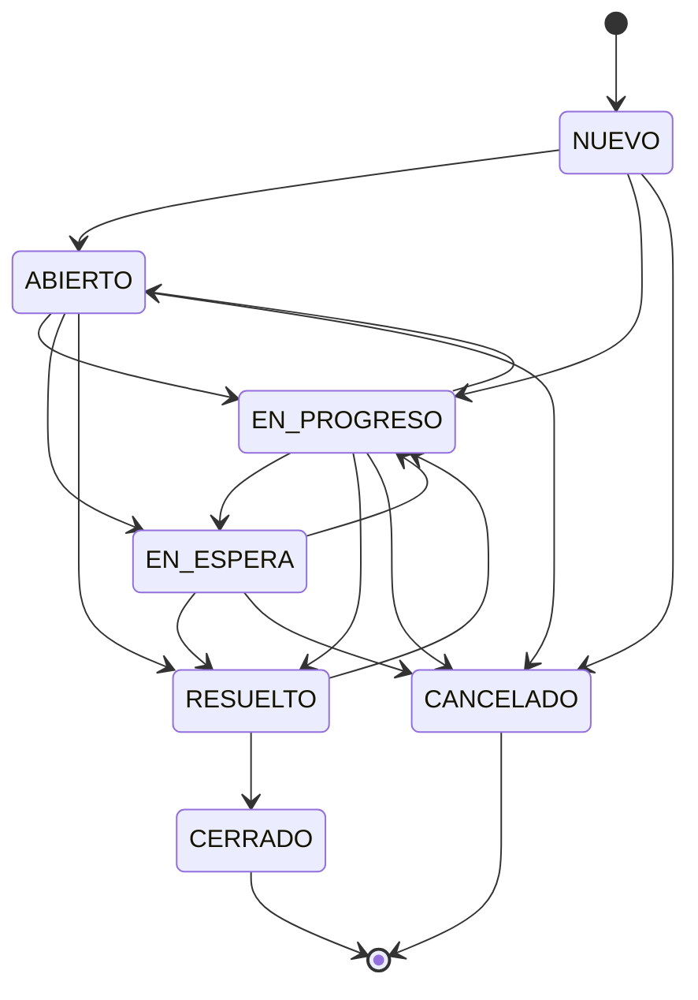
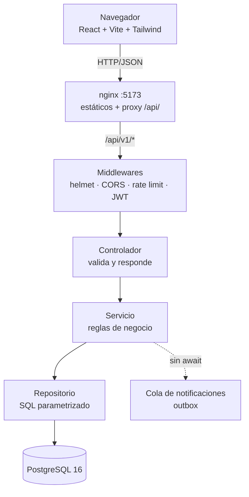

# Explicación paso a paso del Sistema de Tickets

> Guion para explicarle el proyecto al profesor, en el orden en que conviene
> contarlo: primero se lo muestras funcionando, después abres la base de datos,
> luego explicas las reglas y al final la arquitectura. Cada paso trae los
> comandos exactos y lo que hay que decir.
>
> **Regla de oro:** no empieces por el código. Empieza por el problema y por el
> sistema funcionando. El código se explica solo cuando ya entendió qué hace.

---

## Índice

1. [Resumen en 30 segundos](#1-resumen-en-30-segundos)
2. [Paso 1 — Levantarlo y verlo funcionar](#2-paso-1--levantarlo-y-verlo-funcionar)
3. [Paso 2 — Dónde está la base de datos](#3-paso-2--dónde-está-la-base-de-datos)
4. [Paso 3 — Las reglas de negocio](#4-paso-3--las-reglas-de-negocio)
5. [Paso 4 — Cómo está armada por detrás](#5-paso-4--cómo-está-armada-por-detrás)
6. [Paso 5 — Despliegue: local y nube](#6-paso-5--despliegue-local-y-nube)
7. [Paso 6 — Los dos repositorios](#7-paso-6--los-dos-repositorios)
8. [Preguntas probables y respuesta corta](#8-preguntas-probables-y-respuesta-corta)
9. [Guion de demo de 5 minutos](#9-guion-de-demo-de-5-minutos)
10. [Checklist antes de la exposición](#10-checklist-antes-de-la-exposición)

---

## 1. Resumen en 30 segundos

> «Es un sistema de *helpdesk* que digitaliza el ciclo completo de una
> incidencia: desde que un usuario la reporta hasta que se cierra y se
> contabiliza. Resuelve tres problemas concretos de las áreas de soporte: se
> pierden casos, no hay trazabilidad de quién atendió qué, y no existen métricas
> para saber si se cumplen los acuerdos de nivel de servicio.
>
> Está construido con Node.js + Express en el backend, React en el frontend y
> PostgreSQL como base de datos, todo orquestado con Docker Compose. Tiene tres
> roles, una máquina de estados explícita, auditoría inmutable por trigger y
> reportes en PDF y Excel.»

Si solo tienes un minuto, eso es todo lo que necesitas decir.

---

## 2. Paso 1 — Levantarlo y verlo funcionar

### Lo que dices

> «El sistema se levanta con un solo comando. No requiere instalar Node,
> PostgreSQL ni nada por el estilo: todo corre en contenedores.»

### Lo que haces

```bash
# 1. Verificar que Docker Desktop está abierto
docker --version

# 2. Levantar los tres servicios (la primera vez tarda varios minutos)
docker compose up -d --build

# 3. Cargar los datos de demostración
docker compose exec backend npm run db:seed

# 4. Comprobar que todo está sano
curl http://localhost:4000/api/v1/salud
```

En Windows también existen `INICIAR.bat` y `DETENER.bat`, que hacen exactamente
lo mismo con doble clic.

### URLs que debes tener abiertas antes de la exposición

| Servicio | URL | Para qué |
|---|---|---|
| Aplicación web | <http://localhost:5173> | La demo |
| API REST | <http://localhost:4000/api/v1> | Mostrar que es una API real |
| Estado del servicio | <http://localhost:4000/api/v1/salud> | Comprueba backend **y** base de datos |
| Adminer | <http://localhost:8080> | Ver la base de datos (paso 2) |

### Credenciales de demostración

Contraseña común: **`Demo2026#Tickets`**

| Correo | Rol | Para qué sirve en la demo |
|---|---|---|
| `admin@sistema-tickets.local` | ADMINISTRADOR | Usuarios, categorías, reportes |
| `agente1@sistema-tickets.local` | AGENTE | Tomar un ticket y resolverlo |
| `agente2@sistema-tickets.local` | AGENTE | Comparar carga de trabajo |
| `usuario1@sistema-tickets.local` | SOLICITANTE | Crear un ticket |
| `usuario2@sistema-tickets.local` | SOLICITANTE | Demostrar que **no** ve tickets ajenos |
| `usuario3@sistema-tickets.local` | SOLICITANTE | Tercer punto de comparación |

> **Aclaración obligatoria:** estas cuentas son solo para demostración. La
> contraseña es pública y conocida, por eso nunca se cargan en producción.

---

## 3. Paso 2 — Dónde está la base de datos

Esta es la pregunta que más suele hacer un profesor, porque es donde se ve si el
proyecto es real o una maqueta.

### Lo que dices

> «La base de datos es PostgreSQL 16 y corre en su propio contenedor. Se puede
> inspeccionar de tres formas: desde el navegador con Adminer, desde consola con
> psql, o con cualquier cliente como DBeaver.»

### Opción A — Adminer (la más visual, recomendada para la exposición)

```bash
docker compose --profile herramientas up -d
```

Abrir <http://localhost:8080> y llenar el formulario:

| Campo | Valor |
|---|---|
| Sistema | PostgreSQL |
| Servidor | `postgres` |
| Usuario | `tickets_user` |
| Contraseña | `tickets_pass` |
| Base de datos | `tickets_db` |

> El servidor es `postgres` (el nombre del servicio en Docker Compose), **no**
> `localhost`. Desde dentro de la red de contenedores, cada servicio se llama por
> su nombre.

### Opción B — psql (consola, la más rápida)

```bash
docker compose exec postgres psql -U tickets_user -d tickets_db
```

Dentro de psql:

```sql
\dt                                    -- lista las 8 tablas
\d tickets                             -- estructura de una tabla
SELECT * FROM tickets LIMIT 10;        -- los últimos tickets
SELECT * FROM usuarios;                -- las 6 cuentas demo
SELECT * FROM historial_tickets
  ORDER BY creado_en DESC LIMIT 20;    -- la bitácora de auditoría
\q                                     -- salir
```

### Opción C — DBeaver, pgAdmin o cualquier cliente

| Parámetro | Valor |
|---|---|
| Host | `localhost` |
| Puerto | `5432` |
| Base de datos | `tickets_db` |
| Usuario | `tickets_user` |
| Contraseña | `tickets_pass` |

### Qué mostrar exactamente en la demo de la base de datos

1. **`\dt`** → las 8 tablas: `usuarios`, `categorias`, `tickets`, `comentarios`,
   `adjuntos`, `historial_tickets`, `notificaciones`, `tokens_refresco`.
2. **`SELECT * FROM categorias;`** → las 7 categorías con su SLA en horas.
3. **`SELECT codigo, titulo, estado FROM tickets LIMIT 5;`** → el folio legible
   `TK-2026-000001`.
4. **`SELECT * FROM historial_tickets LIMIT 5;`** → la auditoría, que se escribe
   por trigger y no se puede desactivar desde la aplicación.
5. **Las 2 vistas**: `vista_resumen_tickets` y `vista_desempeno_agentes`, que
   alimentan el dashboard sin traer todas las filas a la aplicación.

### Dos advertencias que conviene decir en voz alta

- Los scripts de `database/init/` **solo se ejecutan cuando el volumen está
  vacío**. Si se cambia el esquema y no se ve el cambio, hay que recrear:
  `docker compose down -v` (eso borra los datos).
- El contenedor guarda los datos en el volumen `tickets_postgres_data`, así que
  sobreviven a un `docker compose down` normal.

---

## 4. Paso 3 — Las reglas de negocio

### Lo que dices

> «Las reglas no están repartidas por el código: están concentradas en la capa
> de servicio y en un archivo de constantes que es la única fuente de verdad.
> Estas son las que un revisor puede verificar.»

### 4.1 Los tres roles

| Rol | Qué puede hacer |
|---|---|
| **SOLICITANTE** | Crear tickets, adjuntar evidencia, comentar y ver **solo los suyos** |
| **AGENTE** | Ver todo el catálogo, autoasignarse, cambiar estados, notas internas, resolver |
| **ADMINISTRADOR** | Todo lo anterior + usuarios, categorías, SLA, reportes y reintento de notificaciones |

**Regla clave — autorización por fila:** si un solicitante adivina el UUID de un
ticket ajeno, el sistema responde **404, no 403**. Un 403 confirmaría que el
ticket existe; un 404 no revela nada.

### 4.2 La máquina de estados



Las transiciones están en un mapa explícito (`TRANSICIONES_PERMITIDAS` en
`src/config/constants.js`), no en una cadena de `if`.

**Por qué 409 y no 400:** una petición que pide pasar de `NUEVO` a `CERRADO`
está **bien formada** — `CERRADO` es un estado válido del enumerado. Lo que no
encaja es el estado **actual del recurso**. Eso es un conflicto (409), no una
petición mal hecha (400).

**Detalle de la reapertura:** un ticket `RESUELTO` puede volver a `EN_PROGRESO`.
Un solicitante que no quedó conforme no debería abrir un ticket nuevo y perder el
historial. `CERRADO` y `CANCELADO` sí son terminales.

### 4.3 Quién puede hacer qué

- Solo **agente o administrador** pueden mover a `RESUELTO`, `EN_PROGRESO` o
  `EN_ESPERA`. El solicitante solo puede cerrar o reabrir el suyo.
- Pasar a `RESUELTO` **exige una solución de al menos 10 caracteres**. Sin eso
  el cierre no es auditable ni sirve para los informes.
- Un ticket `CERRADO` o `CANCELADO` es **inmutable**: no se puede editar. Esto
  protege la evidencia histórica.
- Solo se asigna a usuarios con rol `AGENTE` o `ADMINISTRADOR`; un agente no
  puede reasignar el ticket de otro agente.
- El borrado es **lógico** (`eliminado_en`), nunca físico: borrar un ticket
  rompería la trazabilidad de lo que pasó.

### 4.4 Reglas de autenticación

- El registro público crea **siempre** `SOLICITANTE`. El rol no se acepta del
  cliente: si se aceptara, cualquiera se haría administrador editando el JSON.
- Correo inexistente y contraseña incorrecta devuelven **el mismo error
  genérico**, para que no se pueda averiguar qué correos están registrados.
- Contraseñas con **bcrypt, coste 12**. La comparación tarda lo mismo acierte o
  falle, así que no filtra información por tiempo de respuesta.
- **Refresh tokens con rotación**, guardados únicamente como *hash*: si la base
  se filtra, los tokens robados no sirven.
- Cambiar la contraseña **revoca todas las sesiones**. Si no, quien tuviera una
  sesión abierta seguiría dentro.

### 4.5 Reglas operativas

- **SLA automático por categoría**, calculado desde las horas comprometidas:

  | Categoría | SLA |
  |---|---|
  | Red e Internet | 8 h |
  | Base de Datos | 12 h |
  | Correo Electrónico | 12 h |
  | Accesos y Cuentas | 16 h |
  | Hardware | 24 h |
  | Software | 48 h |
  | Solicitud de Servicio | 120 h |

- **Folio legible** `TK-2026-000001`, generado por una **secuencia de
  PostgreSQL**. Generarlo en JavaScript tendría una condición de carrera: dos
  peticiones simultáneas podrían obtener el mismo número.
- **Bitácora inmutable** por *trigger*: incluso una escritura directa por SQL
  queda registrada.
- **Notificaciones tipo outbox**: se guardan antes de enviarse y no bloquean la
  respuesta. Si el servidor de correo está caído, el ticket igual se crea y la
  notificación queda para reintento.
- **Adjuntos**: se valida el tipo MIME **y** los *magic numbers* binarios (un
  ejecutable renombrado a `.png` se rechaza), hay cuota por ticket y se guarda un
  hash SHA-256.

---

## 5. Paso 4 — Cómo está armada por detrás

### Lo que dices

> «Es un monorepo con dos aplicaciones independientes y una base de datos. El
> backend está en capas con dependencias en un solo sentido: el controlador no
> sabe SQL, el repositorio no sabe HTTP, y el servicio no sabe ni lo uno ni lo
> otro. Eso permite probar las reglas de negocio sin levantar nada.»

### Diagrama de componentes



### El recorrido de una petición, en palabras

1. El navegador pide `POST /api/v1/tickets`.
2. **nginx** recibe la petición, ve que empieza con `/api/` y la reenvía al
   backend dentro de la red de Docker.
3. **Middlewares**: helmet añade cabeceras de seguridad, CORS valida el origen,
   el limitador de tasa cuenta la petición, y el middleware de autenticación
   verifica el JWT y deja el usuario en `req.usuario`.
4. **Controlador**: valida el cuerpo con Zod y llama al servicio. No tiene reglas
   de negocio.
5. **Servicio**: aplica las reglas (¿puede este usuario crear?, ¿la categoría
   existe?, ¿el agente tiene rol de soporte?), y si todo pasa llama al
   repositorio.
6. **Repositorio**: ejecuta SQL parametrizado. Nada de concatenar cadenas, así
   que no hay inyección SQL posible.
7. **PostgreSQL**: responde. Los triggers generan el folio, calculan el SLA y
   escriben la bitácora.
8. La respuesta sube por la misma cadena y sale como JSON con un envoltorio
   uniforme.

### Las 8 tablas y las 2 vistas

| Tabla | Qué guarda |
|---|---|
| `usuarios` | Cuentas, rol, hash de contraseña, baja lógica |
| `categorias` | Nombre, descripción y horas de SLA |
| `tickets` | Folio, estado, prioridad, solicitante, agente, fechas de SLA |
| `comentarios` | Conversación pública y notas internas |
| `adjuntos` | Evidencias con hash SHA-256 |
| `historial_tickets` | Bitácora inmutable de cambios |
| `notificaciones` | Cola outbox de correo y SMS |
| `tokens_refresco` | Sesiones activas, guardadas como hash |

| Vista | Para qué |
|---|---|
| `vista_resumen_tickets` | Contadores por estado, prioridad y vencimiento |
| `vista_desempeno_agentes` | Tickets resueltos y tiempo medio por agente |

### Por qué está separado así

- **Responsabilidad única**: `*.repository.js` cambia si cambia el SQL,
  `*.service.js` si cambia una regla, `*.controller.js` si cambia el contrato
  HTTP. Ninguna capa conoce a la de arriba.
- **Inversión de dependencias**: los servicios reciben sus colaboradores por
  constructor (`constructor({ ticketRepository, notificationService })`). El
  `container.js` es el único archivo que conoce las implementaciones concretas.
- **Consecuencia práctica y demostrable**: las **47 pruebas** corren sin base de
  datos, porque inyectan dobles que cumplen el mismo contrato.

### Seguridad en capas

| Capa | Qué hace |
|---|---|
| helmet | 5 cabeceras, incluida `Content-Security-Policy` |
| nginx | Las mismas cabeceras para los documentos estáticos |
| Limitadores | Global (1000/15 min), login (10 intentos), operaciones costosas (20) |
| bcrypt | Coste 12 |
| JWT | Acceso 15 min + refresco 7 días con rotación |
| Consultas | Parametrizadas en todo el repositorio |
| Archivos | MIME + magic numbers, fuera del directorio web, servidos como adjunto |

---

## 6. Paso 5 — Despliegue: local y nube

### Lo que dices (siendo honesto)

> «Ahora mismo el sistema corre en local con Docker Compose. La guía de
> despliegue a la nube está documentada y lista para ejecutarse, pero no se
> publicó porque el plan gratuito duerme la instancia y no era un requisito
> explícito. Si es obligatorio, se hace en una tarde.»

**No digas que está desplegado si no lo está.** Es lo primero que se cae en una
revisión, y no hace falta: el proyecto se sostiene sin eso.

### Local (lo que sí funciona hoy)

```bash
docker compose up -d --build
```

Tres contenedores: `tickets_postgres`, `tickets_backend`, `tickets_frontend`.
Más Adminer opcional con el perfil `herramientas`.

### Nube (lo que está documentado en `docs/DESPLIEGUE-NUBE.md`)

| Proveedor | Base de datos | Backend | Frontend | Costo inicial |
|---|---|---|---|---|
| **Render** (recomendado) | PostgreSQL gestionado | Web Service desde Dockerfile | Static Site | 0 USD (BD 7 USD/mes si se quiere persistencia) |
| **Railway** | Plugin PostgreSQL | Servicio desde Dockerfile | Sitio estático o nginx | ~5 USD de crédito |
| **AWS** | RDS | ECS Fargate / App Runner | S3 + CloudFront | El más caro |

**Topología recomendada (A):** el frontend se compila con
`VITE_API_URL=https://tu-api.onrender.com/api/v1` y se sirve como sitio estático;
el backend va como Web Service desde el Dockerfile; la base es PostgreSQL
gestionado.

**Por qué no la topología B:** el `nginx.conf` del frontend reenvía a
`http://backend:4000`, y ese nombre **solo existe dentro de la red de Docker
Compose**. Desplegado como servicio aislado, el proxy no resuelve y todo
devuelve `502 Bad Gateway`.

### Variables obligatorias en producción

| Variable | Nota |
|---|---|
| `NODE_ENV=production` | Activa validaciones estrictas |
| `JWT_SECRETO` | El arranque falla si falta o si contiene «desarrollo» |
| `DB_*` o `DATABASE_URL` | Datos de conexión del proveedor |
| `CORS_ORIGENES` | Dominio real del frontend, nunca `*` |
| `VITE_API_URL` | Se incrusta en el build: si cambia, hay que recompilar |

> **Aviso honesto sobre almacenamiento:** en los planes gratuitos el disco es
> efímero, así que las evidencias subidas se pierden en cada redespliegue. Para
> producción real hay que usar un disco persistente o un bucket S3.

---

## 7. Paso 6 — Los dos repositorios

Este punto es el que más confusión puede generar, así que conviene decirlo antes
de que lo pregunten.

| | `sistema-tickets/` | `sistema-tickets-spring/` (repo `proyecto-final`) |
|---|---|---|
| Stack | Node.js + Express + React | Spring Boot 3.3.4 / Java 17 |
| Estado | **Funcional**: base de datos, JWT, 47 pruebas | **Esqueleto**: DTOs, controladores y servicios |
| Persistencia | PostgreSQL conectada | Repositorios solo como interfaz |
| Endpoints | 43, funcionando | 43, declarados |
| Código | Backend + frontend completos | 62 archivos Java, ~4.980 líneas |

**Cómo explicarlo:**

> «La versión funcional es Node.js + Express + PostgreSQL. La versión Spring es
> la misma arquitectura por capas reescrita en Java, con los DTOs, controladores
> y servicios ya construidos; lo que falta es la capa de persistencia, que son
> 28 métodos marcados explícitamente. No son dos proyectos distintos: es el
> mismo dominio con dos implementaciones del backend.»

Si el profesor pregunta por qué existen las dos, la respuesta es simple: el
enunciado pedía la estructura en Spring Boot, y la aplicación funcional se
construyó primero para validar las reglas de negocio.

---

## 8. Preguntas probables y respuesta corta

| Pregunta | Respuesta en una frase |
|---|---|
| «¿Dónde está la base de datos?» | PostgreSQL 16 en un contenedor; se inspecciona con Adminer en `localhost:8080` o con `psql` dentro del contenedor. |
| «¿Con qué lo desplegaste?» | En local con Docker Compose; la guía para Render y Railway está documentada y lista, pero no se publicó. |
| «¿Qué pasa si dos usuarios cambian el estado a la vez?» | La transición se valida en el servicio y la base tiene respaldo; el folio se genera por secuencia, no en la aplicación. |
| «¿Cómo evitas inyección SQL?» | Todas las consultas son parametrizadas; no se concatena ninguna entrada del usuario. |
| «¿Por qué 404 y no 403?» | Para no revelar que el recurso existe. Un 403 confirmaría la existencia. |
| «¿Por qué 409 y no 400?» | Porque la petición está bien formada; lo que no encaja es el estado actual del recurso. |
| «¿Cómo sé que las reglas funcionan?» | 47 pruebas automatizadas: 13 de servicio, 23 de errores y 11 de integración. |
| «¿Esto escala?» | El cuello de botella es el pool de conexiones; está medido con k6 (3.452 tickets, 0 errores de servidor, p95 de 8,5 ms) y documentado en `docs/RENDIMIENTO.md`. |
| «¿Qué falta?» | Persistencia en Spring, OpenAPI, pruebas en el repo Spring y despliegue en nube. Todo está listado como pendiente, no oculto. |
| «¿Por qué no hay TypeScript?» | Fue una decisión de alcance; el proyecto usa JavaScript con validación en tiempo de ejecución mediante Zod. |

---

## 9. Guion de demo de 5 minutos

| Minuto | Qué haces | Qué dices |
|---|---|---|
| 0:00 | Abres `localhost:5173` | «Esta es la aplicación. Voy a entrar como solicitante.» |
| 0:30 | Login con `usuario1@…` | «El login devuelve un JWT de 15 minutos y un refresh de 7 días.» |
| 1:00 | Creas un ticket con adjunto | «El folio lo genera la base de datos, no el código.» |
| 1:45 | Cambias a `agente1@…` en otra ventana | «El agente ve el catálogo completo; el solicitante solo ve lo suyo.» |
| 2:15 | Tomas el ticket y lo mueves a `EN_PROGRESO` | «La transición se valida contra el mapa de estados.» |
| 2:45 | Intentas pasarlo directo a `CERRADO` | «Devuelve 409: la transición no es legal desde `EN_PROGRESO`.» |
| 3:15 | Lo resuelves con una solución | «Exige mínimo 10 caracteres; sin eso no hay cierre auditable.» |
| 3:45 | Abres Adminer | «Aquí está la bitácora que escribió el trigger, y la notificación en la cola.» |
| 4:15 | Entras como `usuario2@…` y buscas el ticket de `usuario1` | «404. No le digo ni que existe.» |
| 4:45 | Abres el dashboard de admin | «Los indicadores salen de las vistas, no de sumar en memoria.» |

**Plan B si algo falla:** tener el `docker compose logs -f backend` abierto en
otra pestaña y decir «esto es exactamente lo que el sistema registra cuando algo
no responde». Un fallo explicado con calma vale más que uno oculto.

---

## 10. Checklist antes de la exposición

- [ ] Docker Desktop abierto y los tres contenedores en `Up`
- [ ] `curl http://localhost:4000/api/v1/salud` responde `ok`
- [ ] Datos de demostración cargados (`npm run db:seed`)
- [ ] Adminer levantado (`--profile herramientas`)
- [ ] Las cuatro pestañas abiertas: app, Adminer, `/salud`, logs
- [ ] Dos ventanas de navegador (una por rol) para no cerrar sesión
- [ ] `docs/PREGUNTAS-PARA-EL-PROFESOR.md` impreso o a mano
- [ ] Este documento a la vista
- [ ] Plan B: capturas de pantalla de cada paso, por si falla la red

---

*Documento de apoyo para la sustentación. Complementa a
`GUIA-DE-PRUEBAS-Y-DEMO.md`, `DESPLIEGUE-NUBE.md` y
`PREGUNTAS-PARA-EL-PROFESOR.md`.*
